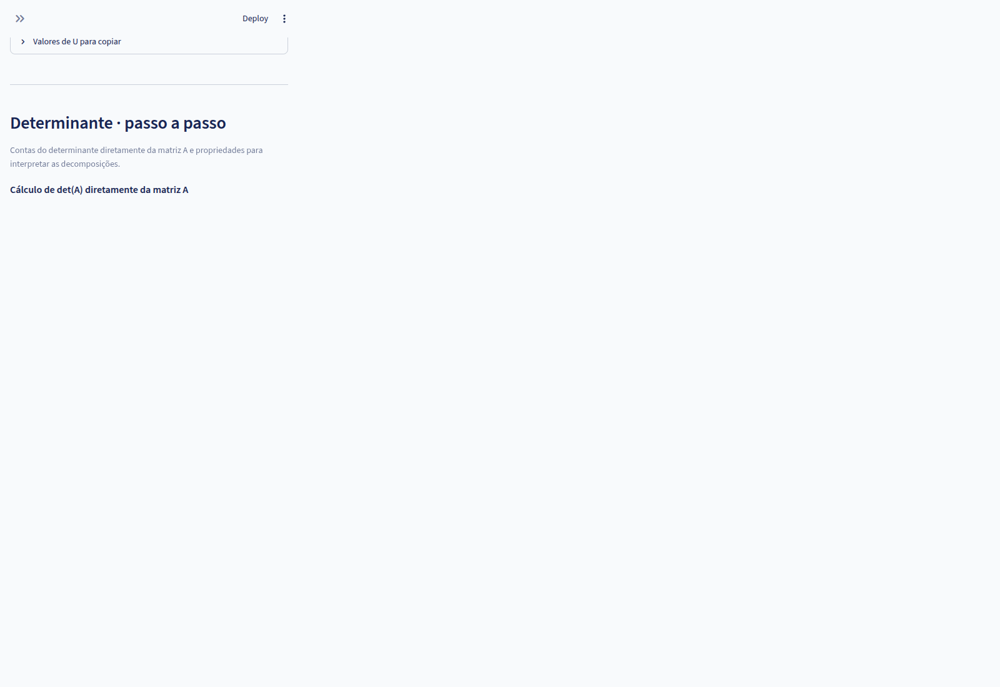

# Manual de Instruções: Laboratório de Decomposições Matriciais

## Identificação acadêmica

Este manual foi preparado no contexto da disciplina de pós-graduação Álgebra Linear Numérica.

- Autores (discentes): Francisco Valderlan Jorge Nobre e Jarbas.
- Professor: Valdisio.

## Para quem é este manual

Este material é voltado para quem precisa:

- usar o aplicativo com segurança, sem tentativa e erro;
- interpretar o diagnóstico numérico antes de escolher o método;
- justificar tecnicamente a escolha de LU, Cholesky, QR ou SVD;
- registrar resultados com evidências (passos, resíduos, reconstrução e exportação JSON).

## O que você consegue fazer com este aplicativo

Dada uma matriz real A (e opcionalmente um vetor b), o sistema permite:

1. validar entrada e limites numéricos;
2. diagnosticar propriedades relevantes da matriz;
3. indicar quais métodos estão disponíveis e por quê;
4. executar uma das 11 variantes de decomposição;
5. acompanhar o passo a passo com fórmulas e contas substituídas;
6. resolver Ax=b quando aplicável;
7. calcular e interpretar determinante com rastreabilidade;
8. exportar o relatório completo em JSON.

---

## 1. Início rápido (10 minutos)

Se você quer começar agora, siga este roteiro:

1. Execute os comandos da Seção 2.
2. Escolha um exemplo pronto na barra lateral.
3. Clique em Analisar matriz.
4. Observe posto, condicionamento k2 e det(A).
5. Escolha um método disponível e clique em Decompor e mostrar os passos.
6. Compare as abas Fatores finais, Passo a passo e Comparação.
7. Em Fatores finais, veja Determinante - passo a passo.
8. Exporte o JSON para anexar no relatório.

Primeiro experimento recomendado:

- LU sem pivotamento em um exemplo simples;
- LU com pivotamento parcial no mesmo exemplo;
- comparação do impacto em pivôs, sinal do determinante e estabilidade.

### 1.1 Tour visual da interface (com telas)

As imagens abaixo mostram a sequência real de uso do sistema.

#### Tela 1 - Entrada da matriz e configuração


O que observar:

- barra lateral com exemplo, tolerância e algarismos exibidos;
- área de entrada da matriz A e vetor b opcional;
- prévia matemática da matriz antes da análise.

#### Tela 2 - Diagnóstico e decisão do método


O que observar:

- métricas centrais: posto, k2 e det(A);
- tabela de métodos disponíveis/bloqueados;
- seletor do método e botão para decompor.

#### Tela 3 - Resultado com fatores finais


O que observar:

- identidade da decomposição escolhida;
- fatores finais (L/U, Q/R, U/Sigma/Vt etc.);
- validação por reconstrução da matriz.

#### Tela 4 - Navegação passo a passo


O que observar:

- controles Primeiro/Anterior/Próximo/Último;
- explicação textual da etapa;
- matrizes antes/depois e contas numéricas do passo.

#### Tela 5 - Determinante com rastreabilidade



O que observar:

- cálculo direto de det(A) por eliminação;
- atualização de sinal em trocas de linha;
- conferência com cálculo direto da biblioteca numérica.

---

## 2. Como executar

Pré-requisitos:

- Python 3.11 ou superior;
- uv instalado no sistema.

Na raiz do projeto:

```bash
uv sync --locked
uv run streamlit run app.py
```

Abra no navegador:

- http://localhost:8501

Para encerrar:

- Ctrl+C no terminal.

Observação:

- Não é necessário ativar o ambiente virtual manualmente.

---

## 3. Mapa da interface

A tela está organizada em três blocos principais:

1. Configuração (barra lateral)
2. Entrada e diagnóstico
3. Resultado e interpretação

### 3.1 Configuração (barra lateral)

| Controle | Função | Impacto prático |
|---|---|---|
| Exemplo | Carrega caso pronto com A e b | Acelera testes e comparações |
| Tolerância relativa 10^-p | Ajusta critério de decisão numérica | Pode mudar disponibilidade de métodos |
| Algarismos exibidos | Controle de precisão visual | Não altera cálculo interno |

### 3.2 Entrada de dados

Você pode informar A em dois modos:

- Texto: aceita espaços, vírgulas, frações e JSON;
- Grade: edição célula a célula com controle de dimensão.

Limites:

- de 1 x 1 até 10 x 10;
- apenas valores reais finitos;
- valores não nulos entre 1e-100 e 1e100.

### 3.3 Diagnóstico e escolha

Após clicar em Analisar matriz, o painel mostra:

- métricas principais;
- explicações numéricas;
- disponibilidade dos métodos com justificativa.

### 3.4 Resultado

Após decompor, o painel abre abas para:

- fatores finais;
- passo a passo;
- solução Ax=b;
- comparação teórica;
- guia teórico.

---

## 4. Como interpretar o diagnóstico

### 4.1 Métricas principais

| Métrica | O que significa | Como usar na decisão |
|---|---|---|
| Dimensão | tamanho de A | define se problema é quadrado, largo ou alto |
| Posto numérico | número de direções independentes | posto baixo indica dependência linear |
| Simétrica | teste A ~ A^T | necessário para Cholesky/LDLT desta implementação |
| Condicionamento k2 | sensibilidade da solução a perturbações | k2 alto exige cautela na interpretação de x |
| det(A) | escala orientada de volume (matriz quadrada) | det próximo de zero sugere proximidade de singularidade |

### 4.2 Leitura prática de k2

Regra operacional:

- k2 perto de 1: problema bem condicionado;
- k2 moderado: solução ainda confiável, com perda limitada de dígitos;
- k2 alto: pequenos erros de entrada podem gerar grande erro em x.

### 4.3 Leitura prática de det(A)

- det(A) = 0: A singular, não invertível;
- det(A) != 0: A invertível (quando quadrada);
- |det(A)| muito pequeno: pode estar perto de singularidade.

Importante:

- det(A) sozinho não substitui análise de posto e condicionamento.

### 4.4 Sequência recomendada de leitura do diagnóstico

Para não se perder, leia nesta ordem:

1. dimensão e formato (quadrada/retangular);
2. posto numérico (há dependência linear?);
3. condicionamento k2 (solução é sensível?);
4. det(A), quando quadrada (há indício de singularidade?);
5. tabela de disponibilidade dos métodos (o que é permitido para este caso).

Exemplo de decisão:

- k2 alto + posto deficiente: prefira SVD para interpretação e solução de norma mínima;
- matriz quadrada com pivôs fracos: prefira LU com pivotamento parcial/total;
- simétrica positiva definida: prefira Cholesky/LDLT.

---

## 5. Determinante no aplicativo

O sistema oferece duas camadas sobre determinante:

1. Diagnóstico rápido:
- det(A), sign(det(A)) e log|det(A)| (para estabilidade de leitura).

2. Passo a passo direto em Fatores finais:
- triangulação de A por eliminação;
- atualização do sinal a cada troca de linha;
- produto da diagonal triangular;
- conferência com numpy.linalg.det.

### 5.1 Regras usadas no passo a passo

Durante a eliminação:

- troca de linhas inverte o sinal do determinante;
- soma de múltiplo de uma linha em outra não altera o determinante.

Fórmula final usada:

- det(A) = sinal acumulado x produto dos elementos diagonais da triangular.

---

## 6. Guia de decisão dos métodos

Use este quadro para escolher método de forma objetiva:

| Situação de A | Método preferencial | Alternativas | Observação |
|---|---|---|---|
| Quadrada, pivôs estáveis | LU sem pivotamento | LU parcial/total | Mais simples para didática |
| Quadrada, pivô fraco ou zero | LU com pivotamento parcial | LU total, SVD | Mais robusto |
| Simétrica positiva definida | Cholesky ou LDLT | LU, QR | Menor custo que LU |
| Retangular m >= n (ajuste) | QR | SVD | Forte para mínimos quadrados |
| Posto deficiente ou singular | SVD | QR Householder/Givens | Melhor para norma mínima |
| Retangular geral | QR Householder/Givens | SVD | LU/Cholesky podem não se aplicar |

Quando priorizar SVD:

- inconsistência em Ax=b;
- posto deficiente;
- necessidade de solução de norma mínima;
- análise mais robusta de direções pequenas.

---

## 7. Interpretação das abas de resultado

### 7.1 Fatores finais

Leia nesta ordem:

1. identidade da decomposição;
2. fatores produzidos;
3. erro de reconstrução;
4. seção Determinante - passo a passo.

Pergunta de validação:

- os fatores reconstruem A com erro pequeno?

### 7.2 Passo a passo

Cada passo registra:

- objetivo;
- operação aplicada;
- contas com substituição numérica;
- estado antes/depois;
- destaque visual.

Use esta aba para justificar metodologia em relatório.

### 7.3 Solução de Ax=b

Para a solução, verifique:

- tipo de solução (única, mínimos quadrados, norma mínima);
- resíduo ||Ax-b||2;
- resíduo relativo escalado.

Lembrete:

- resíduo pequeno não garante erro pequeno em x quando k2 é alto.

### 7.4 Comparação

Use para discussão de custo, hipótese e adequação metodológica.

### 7.5 Guia teórico

Use para fundamentação conceitual e revisão de exemplos.

### 7.6 Como apresentar este resultado em sala

Sequência sugerida para explicação oral:

1. mostrar o diagnóstico (posto, k2, det(A));
2. justificar a escolha do método;
3. exibir dois passos críticos da decomposição (um pivô e uma atualização);
4. mostrar fatores finais e erro de reconstrução;
5. concluir com resíduo da solução e interpretação numérica.

Essa ordem ajuda a evitar uma apresentação apenas operacional, destacando o raciocínio
numérico por trás da escolha do método.

---

## 8. Roteiros pedagógicos sugeridos

### 8.1 Roteiro A - Fundamentos de LU

1. Rode LU sem pivotamento.
2. Identifique multiplicadores em L.
3. Verifique triangularidade de U.
4. Repita com pivotamento parcial.
5. Compare sinal do determinante e estabilidade.

### 8.2 Roteiro B - SPD e Cholesky

1. Carregue exemplo simétrico positivo definido.
2. Execute Cholesky e LDLT.
3. Compare fatores e custo teórico.
4. Relacione positividade com det(A) > 0.

### 8.3 Roteiro C - Posto deficiente

1. Carregue exemplo singular.
2. Tente LU e QR.
3. Execute SVD.
4. Analise solução de norma mínima e resíduos.

---

## 9. Erros comuns e solução rápida

| Sintoma | Causa provável | Ação recomendada |
|---|---|---|
| Método bloqueado | hipótese violada | ler motivo na tabela de métodos |
| Falha por pivô | pivô nulo ou pequeno | usar pivotamento parcial/total |
| Resíduo alto | sistema sem solução exata ou corte numérico | testar SVD e revisar tolerância |
| Valores não aceitos | escala extrema | reescalar matriz e vetor |
| Resultado instável | condicionamento alto | comparar com SVD e relatar sensibilidade |

Boas práticas:

- mantenha tolerância consistente entre comparações;
- compare pelo menos dois métodos quando possível;
- registre erro de reconstrução e resíduo no relatório.

---

## 10. Checklist para relatório técnico

Antes de finalizar um relatório, confirme:

1. matriz A e vetor b documentados;
2. método escolhido e justificativa técnica;
3. principais métricas (posto, k2, det(A));
4. evidência de reconstrução;
5. evidência de resíduo;
6. observações sobre estabilidade numérica;
7. JSON exportado anexado.

---

## 11. Documentação complementar

- README.md
- docs/GUIA_TEORICO.md
- docs/PROJETO.md
- docs/VALIDACAO.md
- examples/casos.json

---

## 12. Observações finais

Este laboratório é didático. Ele foi desenhado para transparência dos cálculos e rastreabilidade
pedagógica. Para problemas científicos de grande escala, use bibliotecas numéricas
especializadas com rotinas otimizadas de produção.
