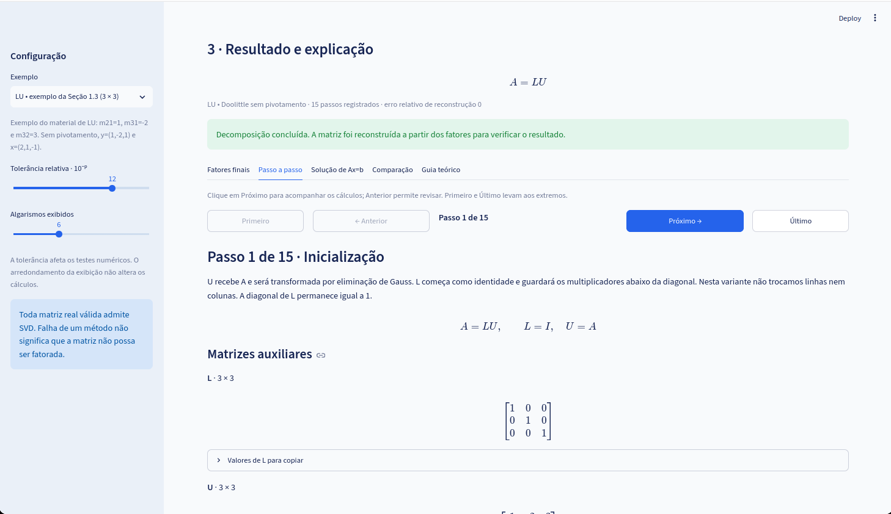
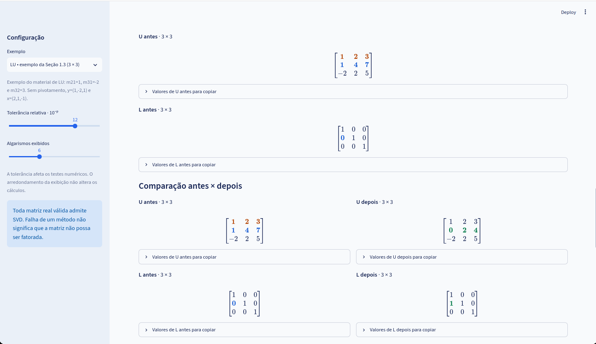
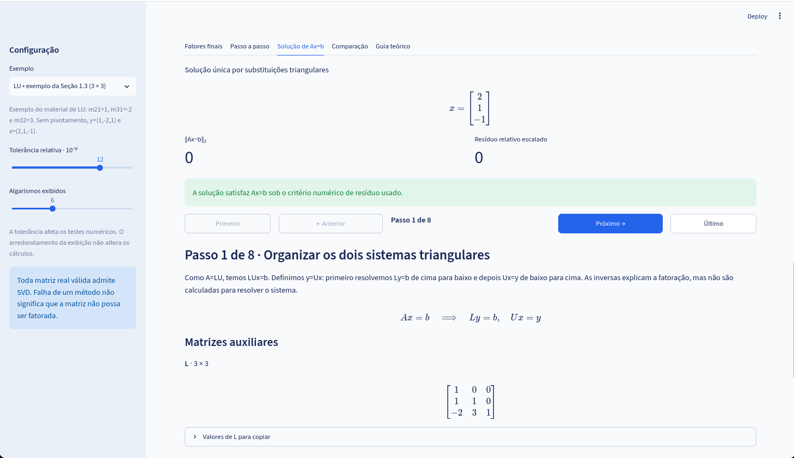
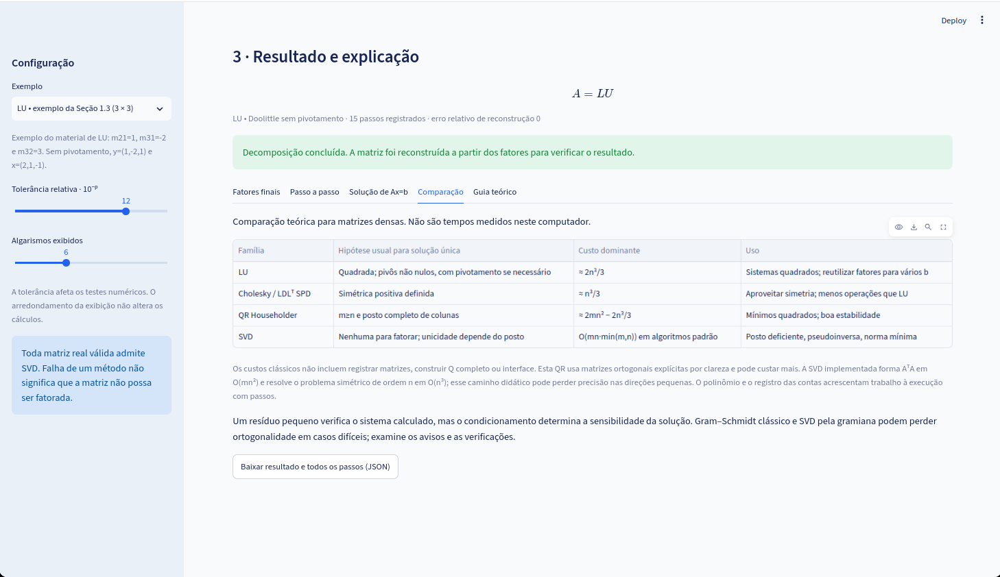
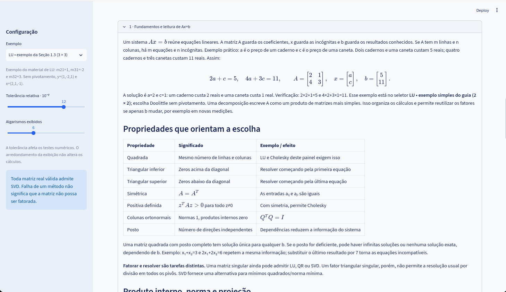

# Manual de Instruções: Laboratório de Decomposições Matriciais

## Identificação acadêmica

Este manual foi preparado no contexto da disciplina de pós-graduação Álgebra Linear Numérica.

- Autores: Francisco Valderlan Jorge Nobre e Jarbas Rocha Martins.
- Professor: Gerardo Valdisio Rodrigues Viana.

## Para quem é este manual

Este material foi escrito para quem deseja usar o laboratório com segurança, compreender o
significado dos indicadores numéricos e justificar, de forma técnica, a escolha de cada
decomposição. Em vez de funcionar apenas como um roteiro de cliques, o texto busca explicar
o comportamento do aplicativo e o raciocínio matemático por trás dos resultados exibidos.
Assim, ele pode ser utilizado tanto no estudo individual quanto na preparação de relatórios
e apresentações da disciplina.

## O que você consegue fazer com este aplicativo

Ao fornecer uma matriz real A, e opcionalmente um vetor b, o sistema valida os dados,
diagnostica propriedades numéricas importantes, indica quais algoritmos podem ser aplicados,
executa a decomposição escolhida e mostra cada etapa com rastreabilidade completa. Além
disso, quando a resolução de Ax=b é pertinente, o aplicativo acompanha o processo de solução
com o mesmo nível de detalhamento, incluindo resíduos, reconstrução da matriz e exportação
de evidências em JSON.

---

## 1. Início rápido

Se você quer começar imediatamente, execute os comandos da Seção 2, selecione um exemplo
pronto na barra lateral, clique em Analisar matriz e, depois, em Decompor e mostrar os
passos. Em seguida, percorra as abas Fatores finais, Passo a passo, Solução de Ax=b,
Comparação e Guia teórico. Esse fluxo já entrega uma visão completa do ciclo de uso:
entrada, diagnóstico, escolha do método, interpretação numérica e documentação do resultado.

Para a primeira exploração, vale repetir o mesmo caso em LU sem pivotamento e LU com
pivotamento parcial. Essa comparação costuma deixar claro por que critérios de estabilidade
numérica mudam o comportamento do algoritmo mesmo quando a matriz é a mesma.

### 1.1 Tour visual da interface (com telas)

As imagens abaixo mostram a sequência real de uso do sistema.

#### Tela 1 - Entrada da matriz e configuração


Nesta etapa você define o contexto inteiro da execução. A barra lateral controla exemplo,
tolerância e quantidade de algarismos exibidos; o painel central recebe a matriz A e,
opcionalmente, o vetor b. A prévia matemática permite verificar imediatamente se a entrada
foi interpretada do jeito esperado antes de partir para análise e decomposição.

#### Tela 2 - Diagnóstico e decisão do método


Aqui o aplicativo transforma a entrada em informação de decisão. As métricas de posto,
condicionamento e determinante aparecem junto da tabela de disponibilidade dos métodos.
Em termos práticos, este é o ponto em que você decide se deve insistir em LU, migrar para
QR ou partir direto para SVD, de acordo com as limitações numéricas do caso.

#### Tela 3 - Resultado com fatores finais


Depois da decomposição, o painel exibe a identidade usada e os fatores finais (L/U, Q/R,
U/Sigma/Vt etc.). O foco aqui é confirmar que os fatores fazem sentido matemático e que a
reconstrução de A é consistente com o erro numérico esperado no problema.

#### Tela 4 - Navegação passo a passo





Nesta visualização você acompanha o algoritmo como uma sequência de estados. Os botões de
navegação permitem percorrer cada transformação e observar, em cada passo, objetivo,
operação, contas substituídas e matrizes antes/depois. Essa aba é especialmente útil para
aprendizagem, revisão de cálculo e defesa metodológica em relatório.

#### Tela 5 - Solução de Ax=b



Quando a opção de resolver o sistema está ativada, esta aba mostra o tipo de solução
obtida, o vetor x calculado e os indicadores de resíduo. O percurso da solução também é
registrado passo a passo, permitindo enxergar como cada decomposição se converte em um
procedimento de resolução (substituições, projeções ou pseudoinversa).

#### Tela 6 - Comparação entre métodos



Esta seção oferece uma leitura transversal das famílias de método. Em vez de focar em um
caso específico, ela organiza hipóteses de aplicabilidade, custo dominante e cenário de uso
mais adequado, ajudando você a explicar por que uma técnica foi escolhida em detrimento de
outra.

#### Tela 7 - Guia teórico



O Guia teórico conecta execução prática e fundamentos matemáticos. As seções expansíveis
retomam conceitos, interpretações e exemplos que sustentam o que apareceu nas abas de cálculo,
servindo como apoio para estudo e para escrita de justificativas conceituais.

---

## 2. Como executar

O projeto requer Python 3.11 ou superior e o gerenciador uv instalado. Na raiz do projeto,
execute os comandos abaixo para sincronizar dependências e iniciar o aplicativo:

```bash
uv sync --locked
uv run streamlit run app.py
```

Em seguida, abra http://localhost:8501 no navegador. Para encerrar a execução, use Ctrl+C
no terminal. Não é necessário ativar o ambiente virtual manualmente, pois o uv já resolve
esse fluxo no momento da execução.

---

## 3. Mapa da interface

A interface foi desenhada em três camadas de trabalho: configuração, entrada/diagnóstico
e resultado/interpretação. A primeira controla parâmetros globais de sessão; a segunda
recebe dados e decide aplicabilidade numérica; a terceira organiza os resultados em abas
com perspectivas diferentes sobre o mesmo cálculo.

### 3.1 Configuração (barra lateral)

| Controle | Função | Impacto prático |
|---|---|---|
| Exemplo | Carrega caso pronto com A e b | Acelera testes e comparações |
| Tolerância relativa 10^-p | Ajusta critério de decisão numérica | Pode mudar disponibilidade de métodos |
| Algarismos exibidos | Controle de precisão visual | Não altera cálculo interno |

O seletor de exemplos é ideal para iniciar estudos e comparações rápidas. A tolerância,
por sua vez, influencia interpretações como posto numérico, simetria efetiva e pivôs
considerados nulos. Já o controle de algarismos atua apenas na apresentação, mantendo os
cálculos internos em ponto flutuante de dupla precisão.

### 3.2 Entrada de dados

A matriz A pode ser fornecida por texto (incluindo frações e JSON) ou por grade editável.
Em ambos os modos, o aplicativo aplica validações de formato e escala. O objetivo desses
limites não é restringir teoria, mas preservar legibilidade didática dos passos e evitar
instabilidades extremas de representação numérica em tempo de execução.

### 3.3 Diagnóstico e escolha

Depois de clicar em Analisar matriz, o sistema resume propriedades numéricas e indica os
métodos possíveis para o caso específico. Esse diagnóstico não é apenas informativo: ele
é a base para decisão técnica do algoritmo, principalmente quando o problema está próximo
de singularidade ou apresenta incompatibilidades com hipóteses estruturais.

### 3.4 Resultado

Após decompor, o painel abre abas complementares para leitura dos resultados. A ideia é
que cada aba responda a uma pergunta distinta: quais fatores foram obtidos, como o método
evoluiu passo a passo, como o sistema Ax=b foi resolvido, como esse método se compara a
outros e onde está a fundamentação teórica correspondente.

---

## 4. Como interpretar o diagnóstico

### 4.1 Métricas principais

| Métrica | O que significa | Como usar na decisão |
|---|---|---|
| Dimensão | tamanho de A | define se problema é quadrado, largo ou alto |
| Posto numérico | número de direções independentes | posto baixo indica dependência linear |
| Simétrica | teste A ~ A^T | necessário para Cholesky/LDLT desta implementação |
| Condicionamento k2 | sensibilidade da solução a perturbações | k2 alto exige cautela na interpretação de x |
| det(A) | escala orientada de volume (matriz quadrada) | det próximo de zero sugere proximidade de singularidade |

Essas métricas devem ser lidas em conjunto. Em geral, decisões robustas não surgem de um
único número isolado, mas da relação entre forma da matriz, posto efetivo e sensibilidade
estimada. Um exemplo clássico é o caso de determinante pequeno: ele pode sugerir problema
delicado, mas a confirmação vem ao observar também singular values e condicionamento.

### 4.2 Leitura prática de k2

O condicionamento k2 mede o quanto pequenos erros de entrada podem amplificar erros na
solução. Quando k2 está próximo de 1, o problema tende a ser estável. À medida que cresce,
a interpretação de x exige mais cautela, porque resíduos pequenos podem coexistir com
soluções sensíveis. Por isso, no relatório, é recomendável sempre apresentar k2 junto de
resíduo e erro de reconstrução.

### 4.3 Leitura prática de det(A)

No caso quadrado, det(A)=0 indica singularidade e ausência de inversa. Quando det(A) é não
nulo, a matriz é invertível. Entretanto, mesmo com det(A) diferente de zero, valores muito
pequenos em módulo podem sinalizar proximidade de singularidade numérica. O aplicativo
inclui sign(det) e log|det| justamente para tornar essa leitura mais estável.

### 4.4 Sequência recomendada de leitura do diagnóstico

Uma sequência útil para evitar conclusões precipitadas é: primeiro verificar dimensão e
formato, depois avaliar posto numérico, em seguida interpretar condicionamento e apenas
então observar determinante e disponibilidade dos métodos. Esse encadeamento reduz o risco
de escolher algoritmo incompatível com o problema e ajuda a justificar tecnicamente a
decisão metodológica.

---

## 5. Como cada decomposição funciona no aplicativo

As decomposições implementadas foram organizadas para fins didáticos, com rastreabilidade
de cada operação. A seguir, estão os principais comportamentos de cada família.

### 5.1 LU (Doolittle, Crout, parcial e total)

Nas variantes LU, o sistema realiza eliminação de Gauss e registra explicitamente pivôs,
multiplicadores e atualizações de linha. Em Doolittle, a diagonal unitária fica em L; em
Crout, a normalização final move essa convenção para U. No pivotamento parcial, a escolha
do pivô percorre a coluna ativa; no total, busca-se o maior elemento no bloco restante,
incluindo trocas de coluna. Essa diferença impacta diretamente estabilidade e sinal do
determinante.

### 5.2 Cholesky e LDLT

Essas variantes são reservadas a matrizes simétricas positivas definidas dentro da tolerância
numérica escolhida. Em Cholesky, a fatoração busca A=LL^T, com diagonal positiva em L.
Em LDLT, a decomposição evita raízes quadradas explícitas, mantendo L unitária e isolando
escalas em D. Ambas são particularmente eficientes quando suas hipóteses são satisfeitas.

### 5.3 QR (Gram-Schmidt, Householder e Givens)

O aplicativo oferece duas abordagens por projeções (Gram-Schmidt clássico e modificado)
e duas por transformações ortogonais (Householder e Givens). As versões por projeção são
muito didáticas para visualizar formação de base ortonormal e matriz R, enquanto Householder
e Givens tendem a ser mais robustas em cenários com dependência ou quase dependência
linear entre colunas.

### 5.4 SVD espectral

A SVD é construída por abordagem espectral a partir de A^T A, com autovalores/autovetores
simétricos, reavaliação de magnitudes e normalização das direções singulares. O processo
é acompanhado por verificações de ortogonalidade e reconstrução, e também por avisos de
precisão em situações mal condicionadas. É a alternativa mais geral para lidar com posto
deficiente e soluções de norma mínima.

### 5.5 Determinante com rastreabilidade

Além do valor direto mostrado no diagnóstico, o painel de fatores finais apresenta o cálculo
de det(A) por eliminação com atualização de sinal em trocas de linha. Isso permite conectar
conceitos teóricos com o comportamento real do algoritmo, inclusive em casos em que pivôs
pequenos afetam a confiabilidade numérica do resultado.

---

## 6. Solução de Ax=b no fluxo da aplicação

Quando a opção de resolver Ax=b está habilitada, o aplicativo usa a decomposição escolhida
para construir o procedimento de solução correspondente. Em LU e nas variantes triangulares,
o caminho passa por substituições sucessivas e regressivas. Em QR, a solução é ligada à
projeção no subespaço das colunas. Em SVD, a pseudoinversa numérica permite tratar casos
sem solução exata e obter solução de norma mínima quando apropriado.

A leitura dos resultados deve considerar tipo de solução, resíduo absoluto e resíduo
relativo escalado. Um ponto essencial é que resíduo pequeno não garante erro pequeno em x
quando k2 é elevado. Por isso, a interpretação correta sempre combina solução, resíduo e
diagnóstico de condicionamento.

---

## 7. Interpretação das abas de resultado

### 7.1 Fatores finais

Esta aba responde à pergunta: qual estrutura algébrica o método produziu? Aqui você confere
a identidade da decomposição, inspeciona fatores finais e valida a reconstrução de A.
Também é o ponto natural para relacionar fatoração, determinante e estabilidade observada.

### 7.2 Passo a passo

A aba Passo a passo transforma o algoritmo em narrativa matemática. Cada etapa explicita
o que foi feito, por que foi feito e qual foi o efeito numérico. Esse nível de detalhe é
fundamental para estudo, auditoria de cálculo e redação de justificativas técnicas.

### 7.3 Solução de Ax=b

Nesta aba, o foco muda de fatoração para resolução. O aplicativo mostra não apenas o vetor
final, mas o percurso numérico que levou até ele, incluindo tratamento de casos de mínimos
quadrados e pseudoinversa. Isso facilita distinguir solução exata de solução aproximada,
algo essencial em problemas com singularidade ou inconsistência.

### 7.4 Comparação

A aba de comparação oferece contexto metodológico. Ela organiza hipótese de uso, custo
dominante e finalidade típica de cada família. Em relatórios, esse quadro serve para justificar
escolha de técnica sem depender apenas de argumento empírico.

### 7.5 Guia teórico

O Guia teórico funciona como base de revisão e aprofundamento. Ele conecta linguagem da
interface com fundamentos de álgebra linear numérica, ajudando a transformar observação de
tela em entendimento conceitual mais sólido.

### 7.6 Como apresentar este resultado em sala

Uma apresentação clara costuma seguir esta ordem: diagnóstico, escolha do método,
demonstração de dois passos críticos, validação por reconstrução e interpretação final da
solução. Esse encadeamento destaca raciocínio numérico e evita que a exposição fique apenas
descritiva ou operacional.

---

## 8. Roteiros pedagógicos sugeridos

Os roteiros abaixo podem ser usados como trilhas de estudo progressivo. No roteiro de LU,
a ideia é observar efeito de pivotamento e estabilidade. No roteiro SPD, o objetivo é
comparar eficiência e hipóteses de Cholesky/LDLT. No roteiro de posto deficiente, a meta
é entender por que SVD se torna central quando há perda de unicidade ou inconsistência.

### 8.1 Roteiro A - Fundamentos de LU

1. Rode LU sem pivotamento.
2. Identifique multiplicadores em L.
3. Verifique triangularidade de U.
4. Repita com pivotamento parcial.
5. Compare sinal do determinante e estabilidade.

### 8.2 Roteiro B - SPD e Cholesky

1. Carregue exemplo simétrico positivo definido.
2. Execute Cholesky e LDLT.
3. Compare fatores e custo teórico.
4. Relacione positividade com det(A) > 0.

### 8.3 Roteiro C - Posto deficiente

1. Carregue exemplo singular.
2. Tente LU e QR.
3. Execute SVD.
4. Analise solução de norma mínima e resíduos.

---

## 9. Erros comuns e solução rápida

| Sintoma | Causa provável | Ação recomendada |
|---|---|---|
| Método bloqueado | hipótese violada | ler motivo na tabela de métodos |
| Falha por pivô | pivô nulo ou pequeno | usar pivotamento parcial/total |
| Resíduo alto | sistema sem solução exata ou corte numérico | testar SVD e revisar tolerância |
| Valores não aceitos | escala extrema | reescalar matriz e vetor |
| Resultado instável | condicionamento alto | comparar com SVD e relatar sensibilidade |

Esses sintomas devem ser interpretados como sinais de incompatibilidade entre hipótese do
método e estrutura numérica do problema, e não como erro da ferramenta em si. Em geral,
combinar ajuste de tolerância, reescalonamento e troca de família de método resolve a maior
parte dos casos de execução problemática.

---

## 10. Checklist para relatório técnico

Antes de finalizar um relatório, confirme:

1. matriz A e vetor b documentados;
2. método escolhido e justificativa técnica;
3. principais métricas (posto, k2, det(A));
4. evidência de reconstrução;
5. evidência de resíduo;
6. observações sobre estabilidade numérica;
7. JSON exportado anexado.

Esse checklist ajuda a manter consistência entre cálculo, interpretação e comunicação dos
resultados, reduzindo lacunas comuns em relatórios de análise numérica.

---

## 11. Documentação complementar

- README.md
- docs/GUIA_TEORICO.md
- docs/PROJETO.md
- docs/VALIDACAO.md
- examples/casos.json

---


